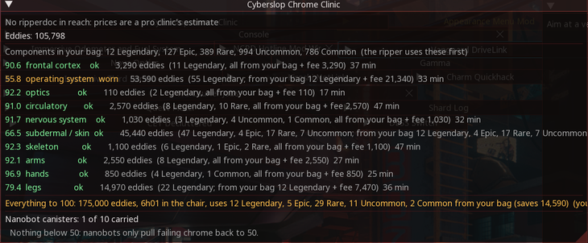

# Chrome Upkeep

Cyberware that wears with use, loses performance as it wears and needs paid servicing at a ripperdoc, with a Chrome Clinic window for the repairs, for Cyberpunk 2077. Single-player only.
Version: Chrome Upkeep 1.7.2, Chrome Clinic 1.1.3 | For game version 2.5 | Status: Chrome Upkeep 1.7.2 and Chrome Clinic 1.1.3 in use in my game and working; no written test record

> This is an unofficial fan work and is not approved/endorsed by CD PROJEKT RED. No game files are included.



## The problem

In the base game, installed cyberware is bought once and then works forever at full strength. There is no upkeep, so the money and the ripperdoc stop mattering once a build is complete.

## What I built

Chrome Upkeep treats installed chrome as machinery that needs upkeep, and Chrome Clinic is a window for the Cyber Engine Tweaks overlay that shows the state of the chrome and offers repairs. Three redscript files (2,939 lines), one Lua window (538 lines), a TweakXL file and an Input Loader file. It changes: the condition of each body system with chrome in it, the performance of worn cyberware, what a ripperdoc visit costs and how long it takes, and it adds nanobot canisters for repairs away from a ripperdoc. The conditions are kept in the save.

- Each body system with chrome in it (operating system, frontal cortex, nervous system, arms, legs, skin, circulatory system, skeleton, optics, hands, immune system) has a condition from 100 % down.
- Using the cyberware wears it: Sandevistan, Berserk and Overclock activations and quickhack uploads, Kerenzikov, cyberarm swings and launcher shots, double and charged jumps, Optical Camo, Blood Pump, hits taken, plus 1 % per game day for every system.
- Below 80 % a system gets a penalty that grows in 5 % steps (longer cooldowns, more RAM per quickhack, lower jumps, less armor, slower regeneration and similar, depending on the system). From 60 % down a system can malfunction (the vanilla "cyberware disabled" effect), and below 10 % it stops working.
- A ripperdoc repairs worn chrome to 100 % for materials at market price plus a fee. Parts already in your bag are used first. Every implant installed or removed takes surgery time, followed by recovery.
- Nanobot canisters, bought at a ripperdoc for 70,000 eddies (up to 10 carried), pull every system below 50 % up to 50 % over 60 game minutes, anywhere.

## How it works

- `CyberslopChromeUpkeep.reds` keeps the condition per system in a persistent scriptable system, listens to cyberware activations, hits and game time through `@wrapMethod` wraps, and applies stat modifiers. Malfunctions use the vanilla "cyberware disabled" status effect.
- `CyberslopChromeClinic.reds` handles the ripperdoc visit. A visit runs from opening a ripperdoc's menu to leaving it; checkout happens a moment after leaving: trauma care (with the Injuries mod), service, surgery time, a clock jump by the total, then recovery. Clinic quality (street, pro, top) changes surgery time, the fee and the complication chance.
- `CyberslopChromeRepair.reds` prices repairs from parts: materials (components of the implant's quality, at market price) plus the ripperdoc's fee, lowered by Street Cred. One repair plan is shared by "repair all", the chair service and the window's total, so the bag and the money go to the worst system first.
- The Chrome Clinic window only shows and asks; all rules and prices live in the redscript part. It opens by itself next to a ripperdoc (within 4 m, or 6 m from the one whose menu you opened).
- The TweakXL file lowers the floors of five stats, so penalties on cooldowns, buff duration and arm stamina cost can reach their full size. The Input Loader file adds a "Treat injuries" button to the ripperdoc cyberware screen.
- Optional mods are compiled in only when present (`@if(ModuleExists(...))`): RedFileSystem, DigitalVixen Core, Injuries, Dark Future, Trauma Team and Cashflow.
- The source audit checked all 17 wrap targets against the 2.5 game scripts: they match.

```text
package/
  r6/scripts/zz_CyberslopChromeUpkeep/CyberslopChromeUpkeep.reds   wear, penalties, malfunctions, settings
  r6/scripts/zz_CyberslopChromeUpkeep/CyberslopChromeClinic.reds   the ripperdoc visit: surgery time, recovery, clinic quality
  r6/scripts/zz_CyberslopChromeUpkeep/CyberslopChromeRepair.reds   repair quotes and nanobot canisters
  r6/tweaks/zz_CyberslopChromeUpkeep/ChromeUpkeepStatLimits.yaml   lower floors for five stats
  r6/input/CyberslopChromeUpkeep.xml                               "Treat injuries" button in the ripperdoc screen
  bin/x64/plugins/cyber_engine_tweaks/mods/CyberslopChromeClinic/init.lua   the Chrome Clinic window
```

## Requirements

| Requirement | Version | Link |
|---|---|---|
| Cyberpunk 2077 | 2.5 | |
| Cyber Engine Tweaks | a build for 2.5 | [Nexus Mods, mod 107](https://www.nexusmods.com/cyberpunk2077/mods/107) |
| redscript | a build for 2.5 | [Nexus Mods, mod 1511](https://www.nexusmods.com/cyberpunk2077/mods/1511) |
| TweakXL | a build for 2.5 | [Nexus Mods, mod 4197](https://www.nexusmods.com/cyberpunk2077/mods/4197) |
| Codeware | a build for 2.5 | [Nexus Mods, mod 7780](https://www.nexusmods.com/cyberpunk2077/mods/7780) |
| Mod Settings | a build for 2.5 | [Nexus Mods, mod 4885](https://www.nexusmods.com/cyberpunk2077/mods/4885) |
| Input Loader | a build for 2.5 | [GitHub](https://github.com/jackhumbert/cyberpunk2077-input-loader) |

Cyber Engine Tweaks is needed for the Chrome Clinic window, Input Loader for the "Treat injuries" button. The scripts call Mod Settings directly and do not compile without it.

Optional, used only when installed: [RedFileSystem](https://www.nexusmods.com/cyberpunk2077/mods/13378) (writes the log to a file), [Dark Future](https://www.nexusmods.com/cyberpunk2077/mods/16300), [Injuries](https://www.nexusmods.com/cyberpunk2077/mods/30508) (trauma care at the ripperdoc, recovery after surgery), [DigitalVixen Core](https://www.nexusmods.com/cyberpunk2077/mods/28390) (hit locations), Trauma Team, and Cashflow from the same author's Cyberpunk 2077 mod collection (money tags).

Requirements are not bundled. Install them first.

## Install

1. Install the requirements above.
2. Copy the contents of `package/` into the game folder, so that `r6\scripts\zz_CyberslopChromeUpkeep\CyberslopChromeUpkeep.reds` exists.
3. Start the game and load a save. Mod Settings shows "Cyberslop Chrome Upkeep"; the "Cyberslop Chrome Clinic" window opens when you stand next to a ripperdoc.

## Uninstall / roll back

1. Close the game.
2. Delete:
   - `r6\scripts\zz_CyberslopChromeUpkeep\`
   - `r6\tweaks\zz_CyberslopChromeUpkeep\`
   - `r6\input\CyberslopChromeUpkeep.xml`
   - `bin\x64\plugins\cyber_engine_tweaks\mods\CyberslopChromeClinic\`
   - `r6\storages\CyberslopChromeUpkeep\` (log files, only present with RedFileSystem)
3. The chrome conditions and the nanobot canisters are stored in the save. Without the mod the game does not read them; the canisters you carry are lost.
4. Requirements are left alone. To restore an unmodified game, verify the game files in your launcher.

## Configuration

Mod Settings > Cyberslop Chrome Upkeep:

| Category | Setting | Default | Range |
|---|---|---|---|
| Wear | Chrome wear | on | |
| Wear | Wear rate (%) | 100 | 10 to 300 |
| Wear | Worn and failing penalties | on | |
| Wear | Penalty strength (%) | 100 | 0 to 200 |
| Wear | Malfunctions | on | |
| Clinic | Ripperdoc service | on | |
| Clinic | Repair price (%) | 100 | 25 to 300 |
| Clinic | Repairs use your components | on | |
| Clinic | Surgery takes time | on | |
| Clinic | Surgery time (%) | 100 | 10 to 200 |
| Clinic | Post-op recovery | on | |
| Clinic | Clinic quality | on | |
| Clinic | Surgical complications | on | |
| Clinic | Nanobot canisters | on | |
| Clinic | Ripperdoc trauma care | on | |
| Clinic | Trauma care by button | on | |
| Display | Notices | on | |
| Display | Log to CET gamelog | on | |

The "Treat injuries" button in the ripperdoc cyberware screen is on Y (keyboard) and the left stick press (controller).

Chrome Clinic window: with the CET overlay open it has buttons, and anything that costs money needs two clicks. Without the overlay it only shows. Four hotkeys in CET > Bindings, unbound by default: show / hide the window, repair everything at the ripperdoc, buy one nanobot canister, start a nanobot dose. A hotkey that costs money must be pressed twice within 5 s. "Hide at this ripper" hides the window at the current ripperdoc only.

## Status

| Part | Result |
|---|---|
| Chrome Upkeep 1.0.0 to 1.7.1 | No written in-game test record for any version. |
| Chrome Upkeep 1.7.2 | In use in the author's game and working (author's statement, 2026-11-24). No written test record. |
| Chrome Clinic 1.0.0 to 1.1.2 | No written in-game test record for any version. An offline mock test of the window's fold and expand behaviour passed 14 of 14 checks on 1.1.2; that test is not part of this repository. |
| Chrome Clinic 1.1.3 | In use in the author's game and working (author's statement, 2026-11-24). No written test record. |
| Screenshot | The window at the top was captured in game with the mod running: conditions, prices and components are live values. The version on screen was not recorded. |
| Code check | The source audit checked all 17 wrap targets against the 2.5 game scripts. |

## Compatibility

| Item | Status | Notes |
|---|---|---|
| Dark Future, Injuries, DigitalVixen Core, Trauma Team, RedFileSystem, Cashflow | optional | Compiled in only when installed. Not tested together in a written test. |
| Mods that make cooldown reduction, cyberware buff duration or arm stamina cost negative | not tested | The TweakXL file lowers those stat floors. When it was written, no vanilla record and none of the installed mods made them negative. |
| Input in the ripperdoc menu | checked when written | The "Treat injuries" button uses Y and the left stick press, which were free in the menu input context with the mods installed at the time (other mods there used N, C and P). A mod that binds Y in menus can clash. |

## Known issues

- Logging is on by default on purpose: "Log to CET gamelog" writes the mod's events to the CET game log. With RedFileSystem installed every line is also written to a new file `r6\storages\CyberslopChromeUpkeep\chrome-<n>.txt` per game launch, and old files are not removed. Turn the setting off if you do not need the log.
- The version string inside the Chrome Clinic window file says 1.1.2; the file is 1.1.3.
- No written in-game test exists for either part.

## Engineering notes

There is no written in-game test, so these notes describe fixes and design decisions that the code records. None of them has a written in-game check.

**Penalties that did nothing (1.1.0).** The game clamps the cooldown reduction and cyberware buff duration stats to 0 to 1, so a negative modifier from worn chrome had no effect unless the player already had a positive bonus. The TweakXL file lowers both floors to -1.

**Slow time switched off by worn chrome (1.7.1).** A negative buff-duration stat also failed the "Equal 0" and "Greater 0" checks of the slow-time effects of Synaptic Accelerator, Reflex Recorder and Grenade Spotter, so they gave no slow time at all. A `ScriptableTweak` in the script turns those "Equal 0" checks into "LessOrEqual 0" and logs how many it changed.

**A repair that ended at 99.5 % (1.6.1).** The clinic restored the systems, then moved the clock forward by the chair time, and the next tick charged the 1 % per day drift for the whole chair time to the fresh chrome. The clinic now settles the drift right after its clock skip and then re-applies the restored values.

**Arm penalty cut short (1.7.2).** The three arm stamina-cost stats have a vanilla floor of -1 (+100 % cost), which cut the arm penalty off at about 30 % condition. The TweakXL file lowers that floor to -2 so the penalty reaches its full +160 %. The regeneration and buff-duration floors now also follow other mods' modifiers that come and go.

**Design.** All rules and prices live in redscript; the Lua window only reads and asks. One repair plan feeds the window's total, "repair all" and the chair service, so the numbers shown are the numbers charged.

**Rollback.** Each version was kept in its own release folder with the previous files. For a user: delete the folders listed above.

## Changelog

See [CHANGELOG.md](CHANGELOG.md). Latest: Chrome Upkeep 1.7.2 and Chrome Clinic 1.1.3 (2026-11-23).

## Credits and licence

Runs on Cyber Engine Tweaks, redscript, TweakXL, Codeware, Mod Settings and Input Loader, which are not included here. The clinic tier list is a copy of a table from the same author's Ripper Stock mod, which follows the quality caps of the Ripperdoc Service Charge mod.

MIT, see [LICENSE](LICENSE). The licence covers my code only. Game names and trademarks belong to their owners.

Built with AI assistance (Claude); designed, tested and maintained by me.
